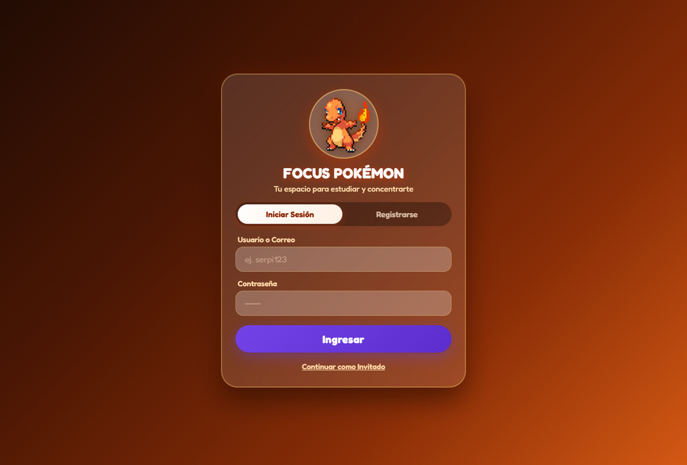
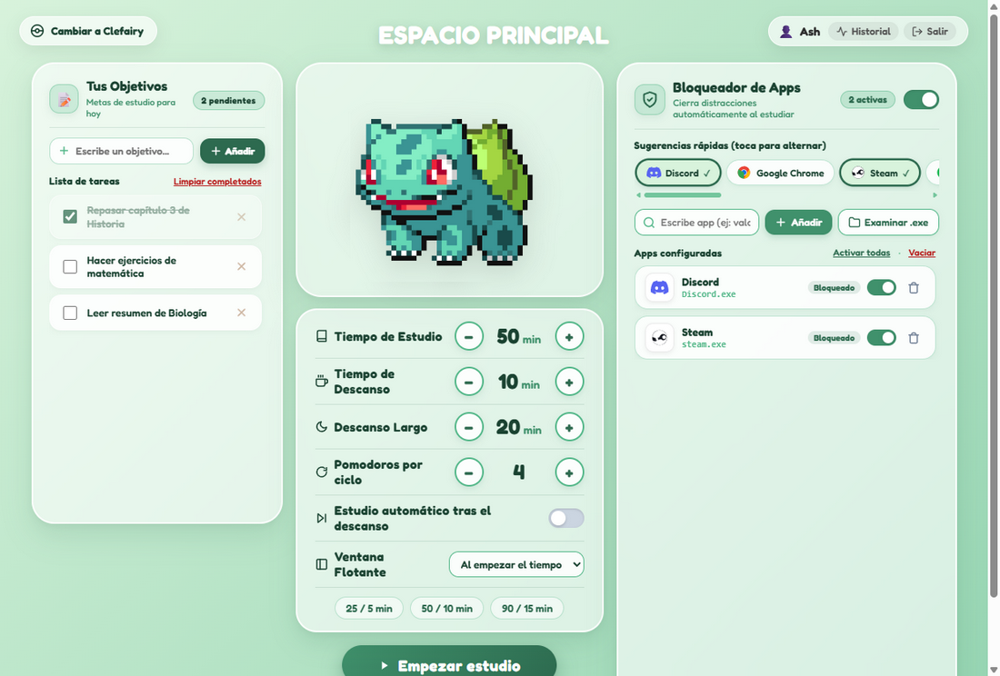
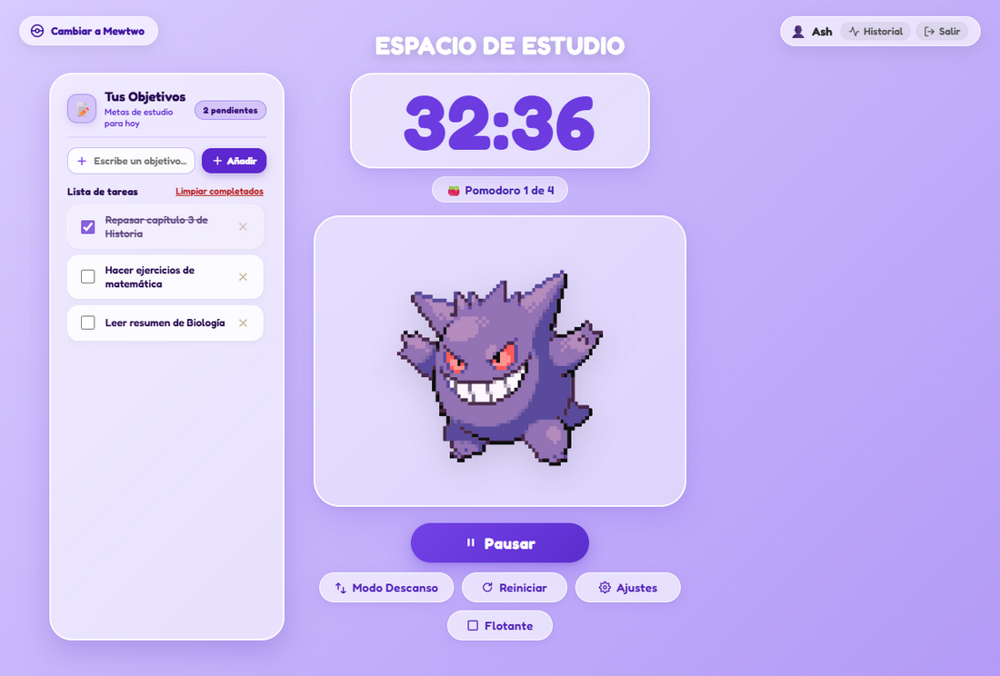
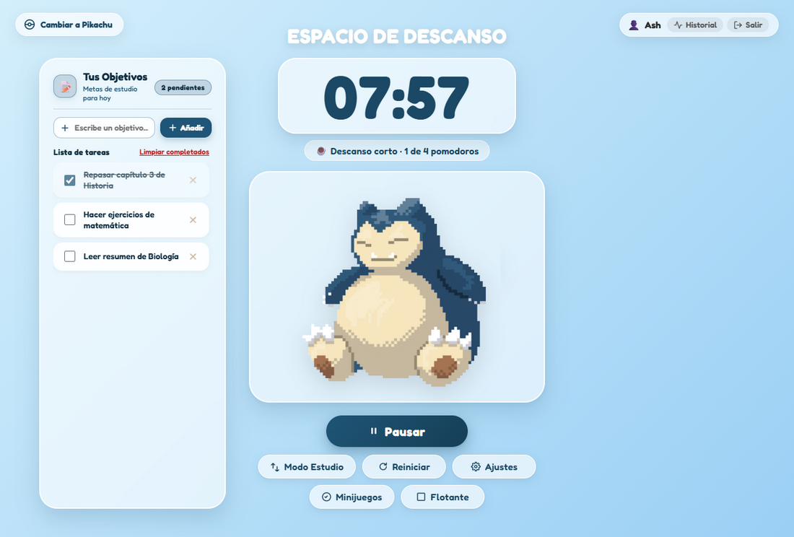
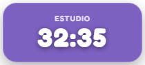
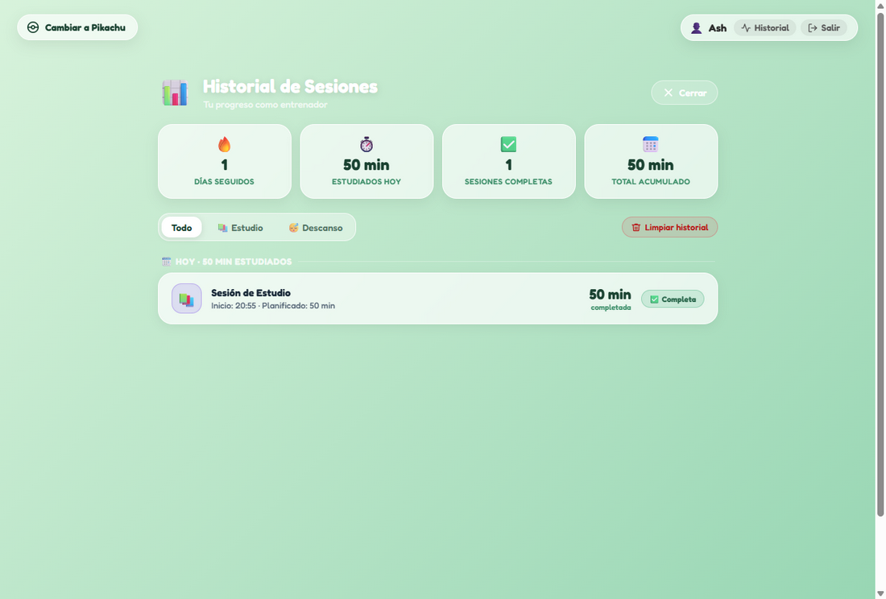
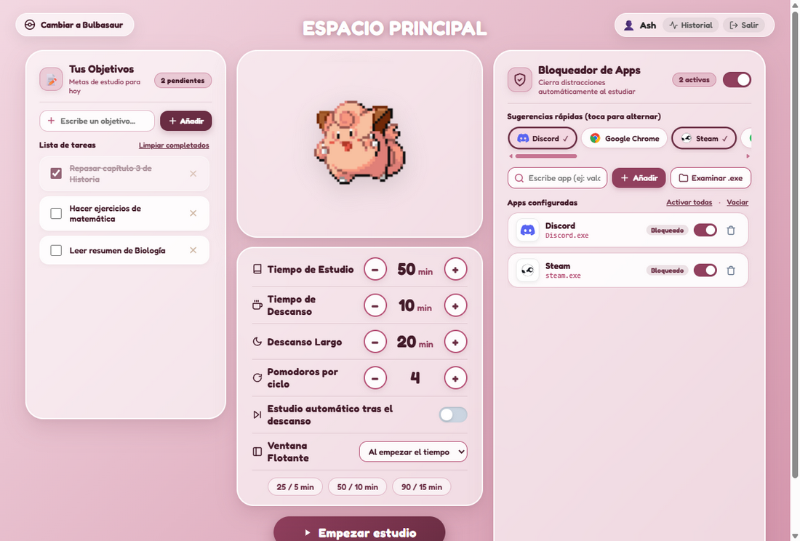
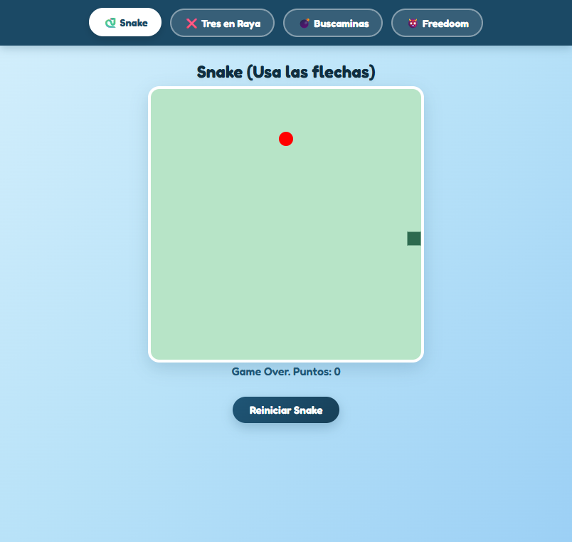
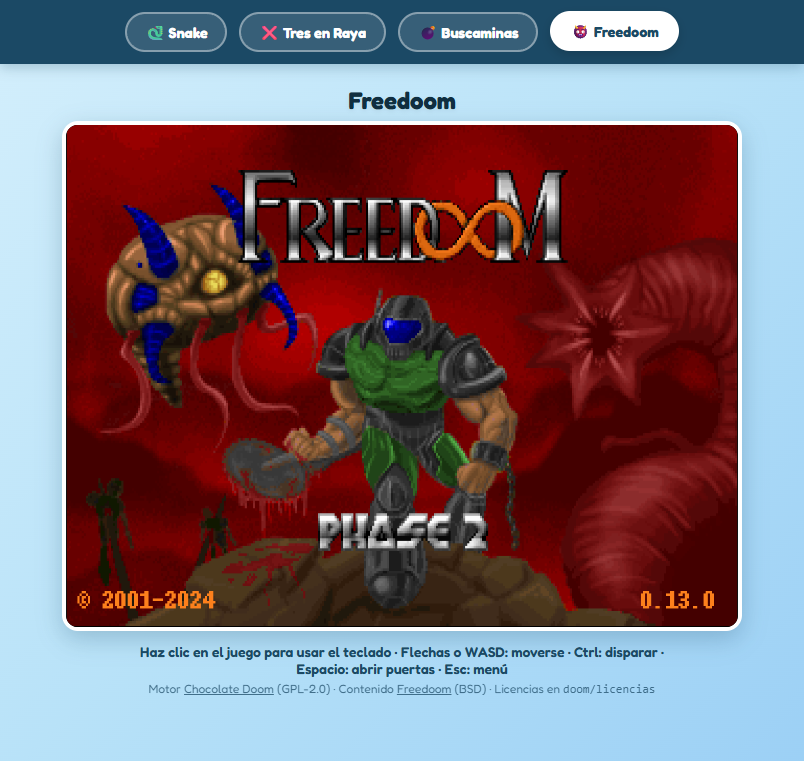

# Manual de usuario de FOCUS

FOCUS es un temporizador para estudiar con el **método Pomodoro**: alternas bloques de estudio
concentrado con descansos cortos y, cada cierto número de bloques, un descanso largo. Mientras
estudias, FOCUS puede cerrar las aplicaciones que te distraen.

> ¿Todavía no la instalaste? Mira la [guía de instalación](INSTALACION.md).

## Índice

1. [Iniciar sesión](#1-iniciar-sesión)
2. [Pantalla principal](#2-pantalla-principal)
3. [Estudiar](#3-estudiar)
4. [Descansar](#4-descansar)
5. [Ventana flotante](#5-ventana-flotante)
6. [Objetivos](#6-objetivos)
7. [Bloqueador de apps](#7-bloqueador-de-apps)
8. [Historial](#8-historial)
9. [Cambiar de Pokémon](#9-cambiar-de-pokémon)
10. [Sala de juegos](#10-sala-de-juegos)
11. [Preguntas frecuentes](#11-preguntas-frecuentes)

---

## 1. Iniciar sesión

Al abrir FOCUS tienes tres opciones:

- **Registrarse:** crea una cuenta con nombre, correo y una contraseña de al menos 6 caracteres.
- **Iniciar sesión:** entra con tu nombre de usuario o tu correo, y tu contraseña.
- **Continuar como invitado:** entra sin cuenta. Todos los invitados de la computadora comparten
  los mismos datos.

Cada cuenta tiene sus propios objetivos, historial, apps bloqueadas y ajustes. Las cuentas se guardan
**solo en esta computadora**: no sirven para entrar desde otro equipo.

Para salir, pulsa **Salir** en la barra de arriba a la derecha.

## 2. Pantalla principal

Es la pantalla de ajustes. Tiene tres partes:

- **Izquierda:** tus [objetivos](#6-objetivos).
- **Centro:** los ajustes del temporizador.
- **Derecha:** el [bloqueador de apps](#7-bloqueador-de-apps).

### Ajustes del temporizador

| Ajuste | Qué hace | Por defecto |
| --- | --- | --- |
| **Tiempo de Estudio** | Duración de cada bloque de estudio (de 1 a 180 min). | 50 min |
| **Tiempo de Descanso** | Duración del descanso corto (de 1 a 90 min). | 10 min |
| **Descanso Largo** | Duración del descanso largo (de 1 a 90 min). | 20 min |
| **Pomodoros por ciclo** | Cuántos bloques de estudio hay antes del descanso largo (de 1 a 8). | 4 |
| **Estudio automático tras el descanso** | Si está activado, el siguiente estudio empieza solo al terminar el descanso. | Apagado |
| **Ventana Flotante** | Cuándo aparece la [ventana flotante](#5-ventana-flotante). | Al empezar el tiempo |

Usa los botones **−** y **+** para cambiar los minutos. Los botones rápidos aplican combinaciones
comunes:

| Botón | Estudio | Descanso | Descanso largo |
| --- | --- | --- | --- |
| 25 / 5 min | 25 | 5 | 15 |
| 50 / 10 min | 50 | 10 | 20 |
| 90 / 15 min | 90 | 15 | 30 |

Los ajustes se guardan solos. Cuando estés listo, pulsa **Empezar estudio**.

## 3. Estudiar

- **Empezar estudio / Pausar / Reanudar:** inicia o pausa el reloj. El tiempo en pausa no cuenta
  como estudio.
- **Modo Descanso:** pasa al descanso sin terminar el bloque (la sesión queda como interrumpida).
- **Reiniciar:** vuelve el reloj al inicio del bloque.
- **Ajustes:** vuelve a la pantalla principal.
- **Flotante:** abre o cierra la [ventana flotante](#5-ventana-flotante).

Debajo del reloj ves en qué pomodoro del ciclo estás, por ejemplo **🍅 Pomodoro 1 de 4**.

Mientras el reloj corre:

- El [bloqueador](#7-bloqueador-de-apps) cierra las apps que elegiste.
- Si la sala de juegos estaba abierta, se cierra.

Cuando el bloque termina, suena un aviso y empieza el descanso automáticamente. Si FOCUS no está a
la vista, también aparece una notificación de Windows y el ícono parpadea en la barra de tareas.

> Puedes minimizar FOCUS o abrir el historial: el reloj sigue funcionando de fondo y no se atrasa.

## 4. Descansar

El descanso empieza solo al terminar un bloque de estudio. Debajo del reloj se indica si es un
**descanso corto** o un **descanso largo** (cuando completas todos los pomodoros del ciclo).

Además de los botones del modo estudio, aquí tienes **Minijuegos**, que abre la
[sala de juegos](#10-sala-de-juegos).

Al terminar el descanso:

- Si **Estudio automático** está activado, el siguiente bloque empieza solo.
- Si no, FOCUS pasa a la pantalla de estudio y espera a que pulses **Empezar estudio**.

## 5. Ventana flotante

Es un reloj pequeño que queda siempre por encima de las demás ventanas, para que veas el tiempo
mientras estudias en otra app.

- Se mueve arrastrándola.
- Muestra si estás en **Estudio**, **Descanso** o **Descanso largo**, y se ve más tenue cuando el
  reloj está en pausa.
- Al pasar el ratón aparece el botón **↗**, que vuelve a abrir FOCUS.

En la pantalla principal eliges cuándo aparece:

| Opción | Cuándo aparece |
| --- | --- |
| **Al empezar el tiempo** | Cuando pulsas Empezar, y se cierra al pausar. |
| **Manual (con botón)** | Solo cuando pulsas **Flotante**. |
| **Al minimizar la app** | Cuando minimizas FOCUS con el reloj en marcha. |

## 6. Objetivos

El panel **Tus Objetivos** es una lista de tareas para la sesión. Se ve en la pantalla principal,
en el estudio y en el descanso.

- Escribe una tarea y pulsa **Añadir** (o Enter).
- Marca la casilla o haz clic en el texto para darla por hecha.
- La **×** borra una tarea.
- **Limpiar completados** borra todas las tareas marcadas.

## 7. Bloqueador de apps

El panel de la derecha de la pantalla principal elige qué aplicaciones se cierran **durante el
estudio**. En el descanso no se cierra nada.

> ⚠️ Las apps se cierran **sin guardar**. Guarda tu trabajo en ellas antes de empezar a estudiar.

- **Interruptor general** (arriba a la derecha del panel): activa o pausa todo el bloqueador.
- **Sugerencias rápidas:** toca una app popular (Discord, Steam, Spotify…) para añadirla o pausarla.
- **Escribir una app:** escribe el nombre del ejecutable (por ejemplo `valorant.exe`) y pulsa
  **Añadir**. Solo se aceptan letras, números, espacios, puntos, guiones y paréntesis.
- **Examinar .exe:** busca el programa en tu computadora; FOCUS toma su nombre y su ícono.
- **En la lista:** el interruptor de cada app la activa o la pausa, y el 🗑️ la quita.
- **Activar todas / Vaciar:** activa todas las apps de la lista o la vacía.

FOCUS revisa cada 3 segundos si alguna app bloqueada está abierta y la cierra. Cada vez que cierra
una, aparece un aviso.

> El bloqueador solo funciona en Windows.

## 8. Historial

Pulsa **Historial** en la barra de arriba. Arriba ves cuatro datos:

- **Días seguidos:** tu racha de días con estudio. No se corta si hoy todavía no estudiaste.
- **Estudiados hoy:** minutos de estudio de hoy.
- **Sesiones completas:** bloques de estudio terminados hasta el final.
- **Total acumulado:** todo el tiempo de estudio registrado.

Debajo están las sesiones agrupadas por día. Cada sesión muestra:

- **✅ Completa** si llegó al final.
- **⚡ Parcial** si la interrumpiste (las de menos de 1 minuto no se guardan).

Los filtros **Todo / Estudio / Descanso** cambian qué sesiones ves. **Limpiar historial** borra todo
el historial de tu cuenta y no se puede deshacer.

Abrir el historial **no detiene** el reloj. Pulsa **Cerrar** para volver a donde estabas.

## 9. Cambiar de Pokémon

El botón de arriba a la izquierda alterna entre dos sets de Pokémon. Cada set tiene su propia
paleta de colores:

| Pantalla | Set clásico | Set alternativo |
| --- | --- | --- |
| Principal | Bulbasaur (verde) | Clefairy (rosa) |
| Estudio | Gengar (violeta) | Mewtwo (lila) |
| Descanso | Snorlax (azul) | Pikachu (amarillo) |

El botón indica a qué Pokémon vas a cambiar, por ejemplo "Cambiar a Mewtwo". La elección se
recuerda en tu cuenta.

## 10. Sala de juegos

Desde el descanso, pulsa **Minijuegos**. La sala se abre en otra ventana y **se cierra sola cuando
empieza el estudio**.

| Juego | Cómo se juega |
| --- | --- |
| 🐍 **Snake** | Usa las flechas para moverte; come manzanas sin chocar con los bordes ni contigo. |
| ❌ **Tres en Raya** | Juegas con X contra la máquina. |
| 💣 **Buscaminas** | Clic izquierdo para descubrir una casilla, clic derecho para poner una bandera. El primer clic nunca es una mina. |
| 👹 **Freedoom** | Doom clásico con contenido libre (ver abajo). |

### Freedoom

Freedoom es un juego de disparos clásico, compatible con Doom, con gráficos, niveles y música
libres. Haz clic dentro del juego para que reciba el teclado.

| Tecla | Acción |
| --- | --- |
| Flechas | Moverse y girar |
| Ctrl | Disparar |
| Alt + flechas | Moverse de costado |
| Espacio | Abrir puertas y usar interruptores |
| Shift | Correr |
| 1 a 7 | Cambiar de arma |
| Tab | Mapa |
| Esc | Menú (nueva partida, opciones, guardar) |

Desde **Esc → Options** puedes cambiar las teclas.

Al cambiar de pestaña o cerrar la sala, la partida se cierra.

## 11. Preguntas frecuentes

**¿Mis datos se suben a internet?**
No. Todo queda guardado en tu computadora, en `%APPDATA%\FOCUS`.

**Olvidé mi contraseña.**
Por ahora no hay forma de recuperarla: las cuentas son locales y la contraseña no se guarda tal
cual, solo un hash que no se puede revertir. Puedes crear una cuenta nueva.

**¿Qué pasa si cierro FOCUS a mitad de un bloque?**
La sesión se guarda en el historial como interrumpida, con el tiempo que llevabas.

**¿Y si la computadora se suspende durante el estudio?**
Al volver, el reloj se pone al día. En el historial nunca se cuenta más tiempo del que planificaste
para ese bloque.

**El reloj de la ventana flotante no coincide con el de la app.**
La ventana flotante se actualiza cada segundo desde la app. Si la cierras y la abres de nuevo,
vuelve a sincronizarse.
